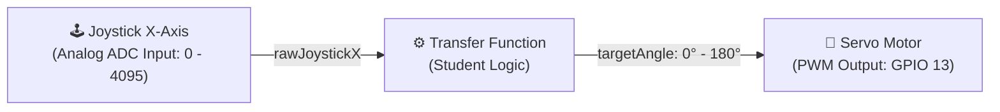

# ESP32 Joystick-Controlled Servo Lab

This repository contains the starter code and exercises for controlling a servo motor using an analog joystick on the ESP32. The primary objective of this lab is to explore and implement different **transfer functions** that map raw physical input to motor output behavior.

---

## 1. System Block Diagram

---

## 2. Hardware Pinout

| Device Component | ESP32 Pin | Signal Type | Range / Description |
| :--- | :--- | :--- | :--- |
| **Joystick X-Axis** | `GPIO 34` | Analog Input (ADC1) | `0` (Left) to `4095` (Right) |
| **Servo Signal** | `GPIO 13` | PWM Output | `0°` to `180°` |
| **Power** | `5V` / `3.3V` & `GND` | Power Supply | Common Ground shared across components |

---

## 3. Transfer Function Challenge

Your goal is to complete section **4.2 (`TRANSFORM FUNCTION`)** inside the main `.ino` sketch. Explore how different mathematical functions affect control precision, response time, and user experience.

### Available Options to Implement & Test:

1. **Linear Mapping (`transferLinear`)**
   * Direct proportional response across a defined angle range.
   * *Parameters to tweak:* Min and Max output angles.
2. **Non-Linear Power Curve (`transferNonLinear`)**
   * Fine precision control near the center resting position with aggressive coarse control at extreme deflections.
   * *Parameters to tweak:* Exponent factor ($1.0$, $2.0$, $3.0$).
3. **Integrating / Memory Control (`transferWithMemory`)**
   * Joystick position acts as a velocity throttle (adding/subtracting from the current position state) rather than controlling absolute position directly.
   * *Parameters to tweak:* Center deadband size, maximum step speed.

---

## 4. How to Run

1. Connect hardware according to the pinout table above.
2. Open the project in **VS Code** with the **PlatformIO / Arduino extension** or use the **Arduino IDE**.
3. Select board: `ESP32 Dev Module`.
4. Select the active transfer function in section `4.2` of the loop.
5. Upload the code and open the **Serial Monitor** or **Serial Plotter** at `115200` baud.

---

# מעבדת שליטה במנוע סרוו באמצעות ג'ויסטיק (ESP32)

מאגר זה מכיל את קוד הבסיס והתרגילים לבקרת מנוע סרוו בעזרת ג'ויסטיק אנלוגי ורכיב ESP32. המטרה המרכזית של מעבדה זו היא לחקור וליישם **פונקציות תמסורת (Transfer Functions)** שונות הממפות את הקלט הפיזי הגולמי להתנהגות מנוע היציאה.

---

## 1. תרשים מלבנים של המערכת

---

## 2. חיווט ופינים (Hardware Pinout)

| רכיב | פין ב-ESP32 | סוג אות | טווח / תיאור |
| :--- | :--- | :--- | :--- |
| **ציר X בג'ויסטיק** | `GPIO 34` | קלט אנלוגי (ADC1) | `0` (שמאלה עד הסוף) עד `4095` (ימינה עד הסוף) |
| **אות סרוו (Signal)** | `GPIO 13` | יציאת PWM | `0°` עד `180°` |
| **הזנה (Power)** | `5V` / `3.3V` & `GND` | אספקת מתח | הארקה משותפת (Ground) לכל הרכיבים |

---

## 3. אתגר פונקציית התמסורת

המטרה שלכם היא להשלים את חלק **4.2 (`TRANSFORM FUNCTION`)** בתוך קוד ה-`.ino` הראשי. חקרו כיצד פונקציות מתמטיות שונות משפיעות על דיוק השליטה, זמן התגובה וחווית המשתמש.

### אפשרויות ליישום ובדיקה:

1. **מיפוי ליניארי (`transferLinear`)**
   * תגובה פרופורציונלית ישרה לאורך טווח זוויות מוגדר.
   * *פרמטרים לשינוי:* זווית יציאה מינימלית ומקסימלית.
2. **עקומת מעריך לא-ליניארית (`transferNonLinear`)**
   * שליטה עדינה ומדויקת סביב נקודת המרכז, לצד תגובה חדה בקצוות.
   * *פרמטרים לשינוי:* מעריך העקומה ($1.0$, $2.0$, $3.0$).
3. **בקרת זיכרון / אינטגרציה (`transferWithMemory`)**
   * הסטת הג'ויסטיק קובעת את מהירות השינוי (הוספה/הפחתה מהזווית הנוכחית) ולא את המיקום האבסולוטי.
   * *פרמטרים לשינוי:* גודל ה"שטח המת" (Deadband) במרכז, מהירות שינוי מקסימלית.

---

## 4. הוראות הרצה

1. חברו את החומרה לפי טבלת הפינים שלמעלה.
2. פתחו את הפרויקט ב-**VS Code** (עם הרחבת PlatformIO / Arduino) או ב-**Arduino IDE**.
3. בחרו בלוח: `ESP32 Dev Module`.
4. בחרו את פונקציית התמסורת הפעילה בסעיף `4.2` בתוך לולאת הקוד (`loop`).
5. העלו את הקוד לרכיב ופתחו את ה-**Serial Monitor** או ה-**Serial Plotter** בקצב `115200` baud.